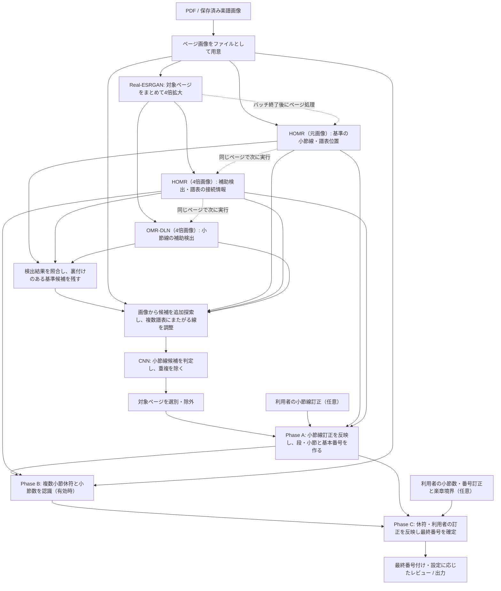

# 現行パイプラインのアーキテクチャ

<!-- translation: {"original":"PIPELINE_ARCHITECTURE.md","source":{"sha256":"46954c89504f6676a832bd43f39c61b45c65fd51286ccb655d3530461512fd65"},"state":"reviewed"} -->

[English / 原文](PIPELINE_ARCHITECTURE.md)

- 原文: [PIPELINE_ARCHITECTURE.md](PIPELINE_ARCHITECTURE.md)（英語正本）
- 翻訳元: same PR。原文SHA-256: `46954c89504f6676a832bd43f39c61b45c65fd51286ccb655d3530461512fd65`
- 状態: `reviewed`。2026-10-29、利用者による読みやすさの確認と、実装照合・Argon独立レビューの結果を踏まえた概要版。

> 本文書は、`develop`の`dense_full_pipeline`を対象とした**アーキテクチャ概要**である。主要な処理、処理間で受け渡す情報、実行順序を説明する。閾値・ファイル形式・ワーカー間の境界・例外処理・互換性の詳細は[実装リファレンス](PIPELINE_ARCHITECTURE_REFERENCE.ja.md)に分けた。動作の最終的な根拠はソースコード・テスト・設定である。

## 1. このパイプラインが行うこと

PDFScoreBarは、楽譜のPDF（または保存済みのページ画像）を読み、小節線と譜表の位置を認識し、楽譜上の小節構造を組み立てて小節番号を付ける。複数小節休符、つまり何小節も休むことを1つの記号で表した部分も認識する。利用者は、小節線の位置や小節数を必要に応じて訂正できる。

処理は大きく3つに分かれる。

| 部分 | 何を判断するか | 主な結果 |
| --- | --- | --- |
| 画像準備と小節線検出 | 小節線と譜表は画像のどこにあるか | 小節線候補、複数の認識結果、譜表の位置 |
| 小節構造の組み立てと休符認識 | どの譜表が同じ段か。小節はどこで区切られ、休符は何小節分か | 基本となる小節構造、複数小節休符による補正情報 |
| 最終番号付けとレビュー | 認識結果と利用者の訂正を反映すると、小節番号はどうなるか | 最終小節番号と、設定に応じた確認・出力用の成果物 |

**譜表**は五線などの音楽を記す横線のまとまり、**段（system）**はページの同じ高さに並び同時に演奏される譜表のまとまり、**小節**は隣り合う小節線の間の音楽上の区間である。段の左右端も小節の境界になる。

## 2. コンポーネントとデータの流れ

HOMRとOMR-DLNは楽譜上の特徴を検出する認識システムである。畳み込みニューラルネットワーク（CNN）は
小節線候補を判定する。別のCNNとRapidOCRは複数小節休符とその小節数を認識する。

図の実線は現在の処理経路のデータの受け渡しを示す。点線はデータではなく実行順序を表す。
全ページのSRプロセスが終了してからページ単位の認識を開始し、各ページでは元画像HOMR、
4倍画像HOMR、OMR-DLNの順に実行する。認識結果は**小節線候補の判断で合流**し、
Phase A〜Cはその判断結果を使って段と小節の構造を作り、番号を確定する。

**なぜHOMRを2回使うのか。** どちらも現在保守しているHOMRの実行環境を使うが、**入力画像と目的が異なる**。元画像のHOMRは小節線の基準位置と、段・小節の構築に使う譜表位置を得る。4倍拡大画像のHOMRは、別の画像から小節線を確認し、譜表同士の接続を判断する情報も得る。OMR-DLNは同じ4倍画像から、もう一つの確認結果を得る。結果の照合では、拡大画像の座標に置き換えるのではなく、裏付けのある元画像の候補位置を残す。4倍画像から得た検出結果や意味情報は、照合や後続の処理で必要に応じて元ページ座標へ戻す。

## 3. 実行順に見る各処理の役割

### 3.1 画像を準備する

必要ならPDFをページ画像ファイルに変換する。Real-ESRGANは対象ページを**1つの処理でまとめて4倍拡大**し、モデルをページ間で再利用する。この処理を終了してGPUメモリを解放した後、ページごとのHOMRとOMR-DLNを実行する。拡大モデルの使い回しと、後続の認識処理とのメモリ競合防止を両立するための順序である。

### 3.2 小節線候補を探し、判定する

まず元画像HOMR、4倍画像HOMR、4倍画像OMR-DLNという3つの認識結果を得る。**結果の照合**では、元画像HOMRが見つけた小節線候補を、4倍画像のHOMRまたはOMR-DLNで確認する。裏付けのある候補は元画像上の位置を保持する。

その後、画像の縦線などを調べて追加候補を探す。この探索をコードでは**probe**と呼び、最初の探索で拾いにくい右端や譜表帯域のすき間などの候補を補う規則を**rescue**と呼ぶ。複数の譜表にまたがる縦線は、元画像の譜表マスクを使い、必要な場合だけ**譜表ごとの線分に分けてから**CNNに渡す。元画像HOMRの基準候補を分割した線分のうち、4倍画像HOMRまたはOMR-DLNの裏付けがあるものも補う。CNNは各候補が小節線らしいかを判定し、その後、同じ譜表上でほぼ重なる候補を整理する。

ここで得られるのは、採択された**小節線の位置**である。どの譜表が同じ段で、各小節がどこに属するかは、次の処理で決める。

### 3.3 段と小節を構築する（Phase A）

ページの選別と、設定された楽章境界の検証の後、Phase Aは任意の小節線の追加・削除を適用してから小節構造を作る。補正後の小節線と**元画像HOMRが得た譜表位置**を使い、同じ段に属する譜表をまとめて各譜表の小節線を対応付ける。

このとき、4倍画像のHOMRが見つけた**譜表の接続情報**も判断材料にする。例えば段の左端付近にある括弧や譜表間の結合を示す記号は、隣り合う譜表が同じ段に属する手掛かりになる。コードでいう**コネクター情報**とはこの種の情報である。4倍画像HOMRの`connector_symbols`と`connector_brace_dot`という2種類のマスク（検出領域を示す画像）を根拠に使う。譜表の位置そのものは元画像の認識結果を基準にする。

出力は`intermediate/<page>/numbering_base.json`。この段階で小節と段の対応関係を定めるので、後続の休符認識や番号付けも**同じ小節を指して処理**できる。

### 3.4 複数小節休符を読む（Phase B）

複数小節休符（MMR）の認識が有効なら、MMR用CNNとRapidOCRで休符記号と、そこに書かれた小節数を読み取る。Phase Aで決めた小節の位置と、利用可能な場合は4倍画像HOMRから元画像座標へ対応付けた縦方向の譜表位置を使い、元画像から読み取り範囲を切り出す。認識結果は`intermediate/<page>/overrides_mmr.json`に記録する。

この処理が必要なのは、**印刷された区切りが1つでも、音楽上は複数の小節に相当する**場合があるためである。段や小節の所属関係はPhase Aの結果を利用する。

### 3.5 訂正を反映し、小節番号を確定する（Phase C）

Phase Cは採択・補正済みの小節線、譜表マスク、利用可能な接続情報からページ構造を再構築し、複数小節休符から得た小節数と、利用者が入力した小節数・番号の訂正、楽章の境界を反映する。楽章境界は、新しい楽章で番号を振り直す位置である。結果を`outputs/<page>/numbering_final.json`へ出力し、必要に応じて番号付きPDFや確認用の成果物の生成に使う。

利用者の訂正は2か所で反映される。**小節線の位置の訂正**はPhase Aの最初に、構造を組み立てる前に適用する。**小節数・番号の訂正**はPhase Cで最終番号付けに反映する。

## 4. 主要モジュールと担当範囲

ここには全ファイルを列挙せず、全体像を追うときに重要なモジュールだけを示す。

| 担当 | 主な実装場所 | 全体の中での役割 |
| --- | --- | --- |
| 処理全体の進行管理 | `src/pipeline/main.py`、`src/pipeline/orchestrator.py`、`src/pipeline/steps/numbering_phases.py` | 入口がorchestratorを呼び、検出の順序を管理してPhase A/B/Cを委譲する |
| production検出処理の選択と実行 | `src/pipeline/detection/__init__.py`、`src/pipeline/detection/dense_orchestrator_batch_sr.py` | 設定に応じて処理を選び、4倍拡大・小節線候補生成・CNNを実行する |
| ページ単位の認識結果の生成 | `src/pipeline/detection/maintained_source_page_worker.py`、`src/pipeline/detection/current_support_worker.py` | 元画像の基準結果と4倍画像の補助結果を生成する |
| 4倍画像のバッチ準備 | `src/pipeline/detection/current_sr_batch_worker.py` | 拡大モデルを再利用し、ページの認識処理の前にSRを完了する |
| 複数小節休符の認識 | `src/pipeline/mmr_geometry_handoff.py`、`src/measure_numbering/mmr.py` | Phase Aの構造を使い、譜表の縦位置を対応付けて休符を認識する |
| CNN向けの候補の調整 | `src/pipeline/steps/staff_strokes.py` | 複数譜表にまたがる縦線を必要に応じて分ける |
| 段・小節の構築 | `src/measure_numbering/pipeline.py` | 譜表位置、小節線、接続情報から小節構造を作る |
| 利用者の確認と最終出力 | `tools/review_correction/`、`src/pipeline/review/apply_corrections.py`、`src/pipeline/review/final_output.py` | レビューアプリが訂正を受け、パイプラインが反映して最終PDFを生成する。注釈付きPDFの再開には`src/pipeline/review/number_layer.py`を使う |

現在の主要経路は[`configs/dense_full_pipeline.yaml`](../configs/dense_full_pipeline.yaml)で`detection.detector_route: dense_full_pipeline`、`detection.homr_profile: maintained_original`として選択される。ページの選別、利用者の訂正、MMR、出力については、それぞれの設定やレビュー操作に応じて実行する。

## 5. 詳細を調べるときの入口

図の工程から目的の処理を選び、必要な箇所だけ詳細リファレンスへ進む。

| 調べたい内容 | 参照先 |
| --- | --- |
| ワーカー、モデル・GPUメモリの利用期間、失敗処理、座標の変換 | [実装リファレンス：実行順序と処理の責任](PIPELINE_ARCHITECTURE_REFERENCE.ja.md#入力から出力までの処理順序) |
| 小節線候補の調整、CNN、閾値、検出元の記録 | [候補の調整](PIPELINE_ARCHITECTURE_REFERENCE.ja.md#入力から出力までの処理順序)、[検出元の記録とスコアリング](PIPELINE_ARCHITECTURE_REFERENCE.ja.md#detector入力のprovenanceとスコアリングのデフォルト) |
| 譜表の接続情報、MMRへの位置情報の引き渡し、最終番号のインデックス | [Phase A](PIPELINE_ARCHITECTURE_REFERENCE.ja.md#譜表小節構造と基本番号付けphase-aコネクターの意味情報と座標の所有権)、[Phase B](PIPELINE_ARCHITECTURE_REFERENCE.ja.md#複数小節休符の認識phase-bmmrサポートの再利用)、[Phase C](PIPELINE_ARCHITECTURE_REFERENCE.ja.md#補正を反映した最終番号付けphase-c削除済みのmmr再構築との違い) |
| 実行コマンドやDocker環境 | [環境ガイド（英語）](ENVIRONMENTS.md) |
| 利用者による訂正手順 | [ユーザーガイド（英語）](USER_GUIDE.md)、[ユーザー補正の境界（英語）](USER_CORRECTION_BOUNDARY.md) |

実装リファレンスには、厳密な受入条件や、過去の調査への参照を残している。この概要では**現在の処理と各工程が必要な理由**に集中する。
