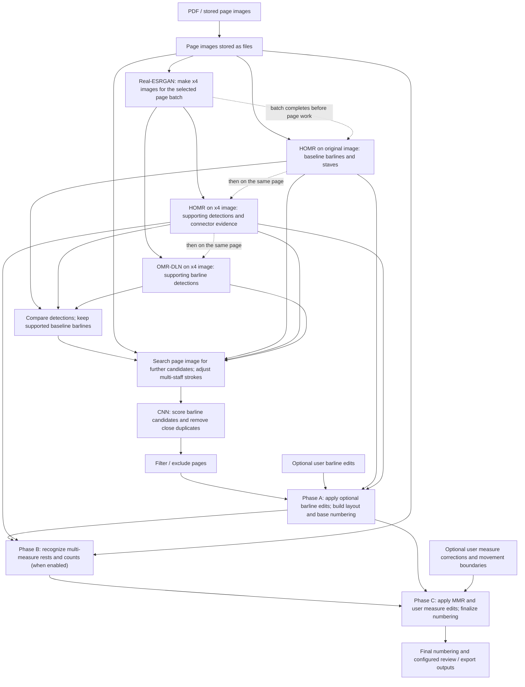

# Current Production Pipeline Architecture

[日本語](PIPELINE_ARCHITECTURE.ja.md)

> This is the architecture **overview** for the `dense_full_pipeline` route currently selected on `develop`. It explains the components, the data passed between them, and the order of execution. For thresholds, file formats, worker boundaries, exceptions and compatibility behavior, use the [implementation reference](PIPELINE_ARCHITECTURE_REFERENCE.md). Source, tests and configuration determine executable behavior.

## 1. What the pipeline does

PDFScoreBar reads a score PDF (or previously saved page images), finds the barlines and the staves to which they belong, reconstructs the musical measures, and assigns measure numbers. It also recognizes multi-measure rests: a single printed symbol that represents several consecutive silent measures. A user can correct detected barlines or measure counts before the numbered result is finalized.

Three cooperating parts perform this work:

| Part | Question it answers | Main result |
| --- | --- | --- |
| Image preparation and detection | Where might the barlines and staves be? | Barline candidates, supporting recognition results and staff positions |
| Measure construction and recognition | Which staves form a system, where are its measures, and how many measures does each rest represent? | Initial measure structure and multi-measure-rest corrections |
| Final numbering and review | How do recognition and user corrections change the measure sequence? | Final measure numbers and, when requested, review/export artifacts |

Here a **staff** is a set of horizontal music lines, a **system** is the group of staves aligned on one row of the page, and a **measure** is a musical interval between consecutive barlines (including the boundaries at a system's edges).

## 2. Component and data flow

HOMR and OMR-DLN are music-recognition systems used here to detect score features.
A convolutional neural network (CNN) scores barline candidates; a separate CNN and
RapidOCR recognize multi-measure rests and their counts.

The diagram shows data dependencies in the selected production route with solid arrows.
Dotted arrows show execution order, not data flow: the all-page SR process finishes
before page-local recognition; within each page the original-image HOMR runs before
x4 HOMR, followed by OMR-DLN. Their recognition results meet in the barline decision;
Phases A–C use that decision to build the layout and finalize numbering.

**Why two HOMR calls?** Both calls use the maintained production HOMR runtime, but process different images for different purposes. HOMR on the **original page** supplies the baseline barline coordinates and the staff positions used to build measures. HOMR on the **four-times-enlarged image** provides independent supporting detections and information about how staves are visually connected. OMR-DLN supplies another check using the same enlarged image. The comparison keeps supported baseline coordinates, rather than replacing them with enlarged-image coordinates. Detections and semantic support from the enlarged image are mapped to original-page coordinates where needed for comparison and downstream use.

## 3. Execution order and decisions

### 3.1 Prepare images

The pipeline renders the PDF into page-image files if needed. Real-ESRGAN then produces enlarged images for all selected pages in **one batch process**, reusing its model. The process ends before the page-by-page HOMR and OMR-DLN work begins. This ordering both reuses the expensive enlargement model and releases its GPU memory before subsequent recognition.

### 3.2 Locate and score barline candidates

Recognition starts from three sources: original-image HOMR, enlarged-image HOMR and enlarged-image OMR-DLN. The **combined decision** checks the original-image candidates against either supporting detector. It retains the original-image candidate's position when that support is present.

The detector then looks for more plausible vertical lines in the page image. This search is called **probe**; its **rescue** rules recover candidates that the first scan could miss, including candidates near the right edge or between detected bands. Using the original-image staff mask, a **staff-stroke adjustment** splits a vertical candidate that spans several staves into staff-local pieces when appropriate. It also adds pieces split from original-image HOMR baseline boxes when they have x4 HOMR or OMR-DLN support. The CNN scores the resulting candidates, after which nearly identical detections of the same staff-local stroke are suppressed.

At this point the output is a set of accepted barline positions, still **not** a complete model of which staves and measures belong together.

### 3.3 Build the musical layout — Phase A

After page filtering and validation of configured movement boundaries, Phase A applies optional user barline additions or removals before constructing the layout. It combines the resulting barline positions with the **original-image staff geometry** to determine which staves belong to a system and how their barlines define aligned measures.

For grouping, it also uses **connector evidence** from enlarged-image HOMR. A connector is visual evidence near the left edge of adjacent staves—such as the joining symbols or braces—that helps decide whether the staves form one system. The x4 HOMR supplies two masks, `connector_symbols` and `connector_brace_dot`, as evidence. A mask is an image marking detected regions. Connector evidence supports the grouping decision; the original-image staff positions remain the layout reference.

Phase A writes `intermediate/<page>/numbering_base.json`. Subsequent stages use its system and measure identities, so they refer to the same physical measures.

### 3.4 Read multi-measure rests — Phase B

When multi-measure-rest recognition is enabled, the MMR CNN and RapidOCR look for rest symbols and their printed counts. They examine the original page image using the positions of measures already defined by Phase A and, when available, vertical staff-position support mapped from enlarged-image HOMR. Phase B records proposed measure-count corrections in `intermediate/<page>/overrides_mmr.json`.

This stage can change **how many musical measures a printed interval represents**. It relies on Phase A's layout rather than constructing a competing set of systems and measures.

### 3.5 Apply corrections and number measures — Phase C

Phase C rebuilds the page structure from the accepted or corrected barlines, staff mask and available connector evidence, then combines the recognized multi-measure-rest counts, any user corrections to measures, and movement boundaries. A movement boundary identifies where numbering resets for a new movement. It produces `outputs/<page>/numbering_final.json` with the final numbering. The review/export path can use this result to generate a numbered PDF and other configured outputs.

There are two correction entry points: **barline corrections** are applied at the start of Phase A before building the physical layout, while **measure/count corrections** affect final numbering in Phase C.

## 4. Where the major responsibilities live

These are the modules worth knowing first. This is a responsibility map, not an exhaustive file inventory.

| Responsibility | Main implementation | Why it matters in the flow |
| --- | --- | --- |
| Coordinate the pipeline | `src/pipeline/main.py`, `src/pipeline/orchestrator.py` and `src/pipeline/steps/numbering_phases.py` | The entry point calls the orchestrator, which schedules detection and delegates Phase A/B/C |
| Choose and run the production detector | `src/pipeline/detection/__init__.py` and `src/pipeline/detection/dense_orchestrator_batch_sr.py` | Select the configured detection route; schedule image enlargement, sources, candidate construction and CNN |
| Produce the per-page recognition sources | `src/pipeline/detection/maintained_source_page_worker.py` and `src/pipeline/detection/current_support_worker.py` | Obtain original-image baseline results and enlarged-image support results |
| Prepare the x4 page batch | `src/pipeline/detection/current_sr_batch_worker.py` | Reuse the enlargement model and finish SR before page recognition |
| Recognize multi-measure rests | `src/pipeline/mmr_geometry_handoff.py` and `src/measure_numbering/mmr.py` | Reuse Phase-A layout, map vertical staff support and recognize rests |
| Adjust barline candidates for CNN | `src/pipeline/steps/staff_strokes.py` | Reconcile multi-staff vertical candidates before scoring |
| Construct systems and measures | `src/measure_numbering/pipeline.py` | Turn positions and connector evidence into the page's measure structure |
| Review and produce final user outputs | `tools/review_correction/`, `src/pipeline/review/apply_corrections.py` and `src/pipeline/review/final_output.py` | The review app accepts corrections; the pipeline applies them and materializes the final PDF. Annotated-PDF resumes use `src/pipeline/review/number_layer.py` |

The canonical route is selected by `detection.detector_route: dense_full_pipeline` and `detection.homr_profile: maintained_original` in [`configs/dense_full_pipeline.yaml`](../configs/dense_full_pipeline.yaml). Optional page filters, user corrections, MMR and output features are controlled by their corresponding configuration or review workflow.

## 5. Inspecting a specific behavior

Start from the stage in the diagram, then follow the corresponding reference section:

| To inspect | Read |
| --- | --- |
| Exact workers, model/process lifetime, failure behavior or coordinate conversion | [Implementation reference — execution and ownership](PIPELINE_ARCHITECTURE_REFERENCE.md#end-to-end-order) |
| Barline candidate normalization, CNN rules, thresholds or detection provenance | [candidate normalization](PIPELINE_ARCHITECTURE_REFERENCE.md#end-to-end-order) and [detector provenance and scoring](PIPELINE_ARCHITECTURE_REFERENCE.md#detector-input-provenance-and-scoring-defaults) |
| Connector evidence, MMR geometry handoff or final numbering indices | [Phase A](PIPELINE_ARCHITECTURE_REFERENCE.md#phase-a-staff-and-measure-structure-connector-semantics-and-coordinate-ownership), [Phase B](PIPELINE_ARCHITECTURE_REFERENCE.md#phase-b-multi-measure-rest-recognition-and-support-reuse) and [Phase C](PIPELINE_ARCHITECTURE_REFERENCE.md#phase-c-final-numbering-with-corrections-not-the-removed-mmr-rebuild) |
| How to run the pipeline and its Docker environment | [Environment guide](ENVIRONMENTS.md) |
| The supported user correction workflow | [User guide](USER_GUIDE.md) and [review boundary](USER_CORRECTION_BOUNDARY.md) |

The implementation reference retains the precise acceptance constraints and links to historical investigations. The overview concentrates on the present path and the reason each stage exists.
