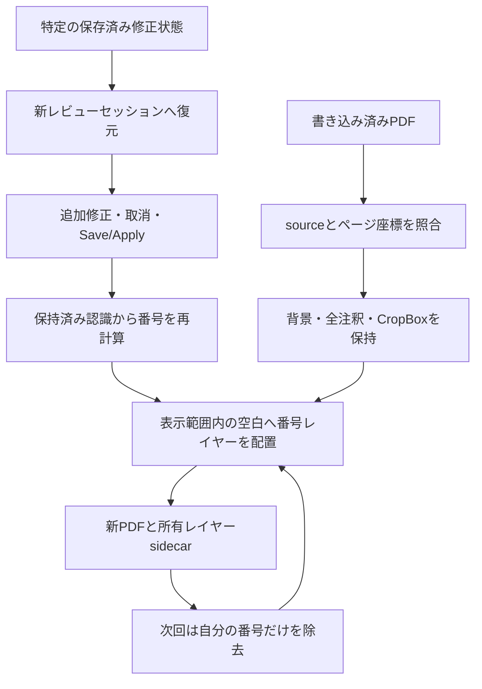

# Issue #441: GitHubレビュー入口

**最新の対応:** [通常レビュー後の3件: null由来情報・3回目以降の再開・番号なしページ](ISSUE441_ADDITIONAL_REVIEW.md)。
オーナーの範囲確定によりPRは通常レビューへ移行済み。以下のDraft/owner待ちの記録は各時点の履歴。

**前段の対応:** [最終レビュー: CI分類・旧履歴GUI・反復往復・4種類のGUI受入](ISSUE441_FINAL_REVIEW.md)。
ユーザー目視結果はPRコメントを正とし、番号の完全な正確性/印刷/merge承認と混同しない。

**前段の往復対応:** [MobileSheetsで番号付きPDFへ追記・再輸出した実データの往復検証と組み込み](ISSUE441_MOBILESHEETS_ROUNDTRIP.md)。
追加された「test」を含む820注釈を保持し、xrefが変わった旧番号160個の交換を検証した。

**前段の画面統合:** [保存履歴・書き込み済みPDF再開の画面統合](ISSUE441_PRODUCT_INTEGRATION.md)。
実ブラウザーから保存履歴選択・取り込み・別セッション・Save/Apply・取消を検証。
製品統合に関する現状と未受入範囲はこの追記を優先する。

**前段の対応:** [PR #445レビュー対応: 全段9pt・段への近接・安全な確定処理](ISSUE441_PR445_REFINEMENT.md)。
[新しい実験集計](issue441/evidence/typography_revision_snapshot.json)と
[11テストの出力](issue441/evidence/typography-focused-tests.txt)を追加した。
以下の8〜10pt・5テストは初回実験の履歴であり、現在の既定値は文書全体9pt。

GitHub上のこのページから、手法・結果・コード・テスト・未実装範囲を確認できる。
ローカルのPDFやログへのアクセスは閲覧の前提にしない。
以下は初回方式実験の記録。現在の画面統合・受入範囲は上記の最新対応を参照。

## 読む順序

1. 本ページの結論・検証表・レビュー論点。
2. [具体手法・実データ実験・exact command](ISSUE441_ANNOTATED_RESUME.md)。
3. [公開用の検証スナップショット](issue441/evidence/annotated_resume_snapshot.json)と
   [5件のfocused test出力](issue441/evidence/focused-tests.txt)。
4. [番号レイヤー](../../tools/issue441/crop_label_layer.py)、
   [修正再開実験](../../tools/issue441/annotated_resume_experiment.py)、
   [テスト](../../tests/test_issue441_annotated_layer.py)の差分。

## 結論と方式

共有された書き込み済みPDFをそのまま土台に、保存済み修正状態を引き継いで番号を更新する。
元画像の交換や白塗りではなく、番号だけを自分のcontent streamとして追加する。
再更新時は所有streamとsidecarを照合し、その番号だけを除いて次の番号へ置き換える。

共有PDFが原譜由来であることを拒否理由にしない。既知sourceとの対応と選択した修正状態を
別々に記録する。元からある手書き数字・印刷数字は削除対象にしない。

## 実験結果

実行コードはcommit `d3b8fa95861a50887217f6a0a9494f744d1f8f58` に固定。
本レビュー資料の整備では保存済み結果を照合・集計した。推論やテストを再実行した結果ではない。
スナップショット生成時に、そのcommitのコードdigest・sidecar・出力PDF digestを再照合した。

| 実験 | 結果 |
| --- | --- |
| 保存状態1を別packageへ復元・再apply | corrections identityと全ページ・全小節番号列が保持済み結果と一致 |
| 保存状態12を別packageへ復元・再apply | 同上。最新状態だけに限定していない |
| MMRの追加修正 | span 5→6。第3ページ先頭の番号158→159 |
| 取消 | 全ページの番号列が元のbaselineへ完全復帰 |
| 4出力の番号配置 | 各出力15ページ・160番号。全bboxが元CropBox内、8〜10 pt |
| 書き込み保持 | 各出力でInk 705・Circle 9・Stamp 15、計729注釈の属性・外観・座標等が一致 |
| 原譜保持 | 背景画像bytes、MediaBox、CropBoxが不変。144 DPIで元のRGBいずれかが250未満の全画素も不変 |
| 所有番号の交換 | 旧streamを除いた全描画が元の書き込み済みPDFと一致してから新番号を追加 |
| 再読込 | 両packageで最終保存identity・current・成功PDFが復元 |
| focused test | 5件成功。更新、空きなし、不可視注釈、改変PDF、改変stream digestを検証 |

ページ別番号数は `9,11,11,11,11,11,8,11,11,11,11,11,11,11,11`。
4出力それぞれのページ別count・CropBox包含・font範囲・出力hashは公開JSONに記載。
元のスコアや手書き本文、correction JSONを公開JSONへコピーしていない。

## 先にレビューしたい論点

- **状態復元とPDF出所の分離:** checkpoint選択と入力PDFのsource/result対応を独立管理する設計。
- **保存・適用の整合性:** Saveでstaleになっても過去成功結果を保持し、applyごとに不変attemptを残す。
  取消でJSON項目順が変わった場合、意味上は同じ修正でも新identityを正しく維持する。
- **番号配置の規約:** 最小8 pt、CropBox内、元の濃い画素不変、全annotation bboxとの重複拒否。
  場所がない行を自動白塗り・過剰縮小で成功扱いしない。実印刷の読みやすさは未受入。
- **自分の番号だけを除去:** marker/stream digest/sidecarを照合し、除去後に元PDF全描画と一致するか確認。
- **外部再exportの境界:** 現PoCの所有レイヤー更新は同じ実験出力とsidecarが対象。
  MobileSheetsで内容を書き換えて再exportされたPDFの一般的な受入は未実装。
- **GUIへの統合:** 書き込み済みPDFを表示用に使い、認識用clean sourceを別に保持する。
  upload→checkpoint選択→追加修正→Save/Apply→PDF表示/downloadは次の製品実装範囲。

## 成功と混同しない過去結果・未実施

| 項目 | 扱い |
| --- | --- |
| 旧固定gutterの配置 | 134/160 bboxがCropBoxをはみ出したFailedを履歴保持。新方式の成功で取り消さない |
| 初回CPU fallback | GPUを渡さなかった再applyは停止し、受入証拠から除外 |
| 初回再読込harness | 取消後identityを初期identityと比較した失敗を保持。最終保存identityとの比較へ是正 |
| 製品GUI・browser E2E | 未統合・未実施 |
| MobileSheetsでの番号付き出力の再export往復 | 未実施 |
| 実印刷・利用者による8〜10 ptの可読性受入 | 未実施 |
| 全修正タイプの組合せ・楽章境界追加の実データE2E | 未実施 |
| Full68・上流再推論 | 未実施。今回の15ページでは保持済み認識を使い、下流MMR OCRのみ再計算 |

下流MMR OCRの実providerは4回とも
`text_rec=['CUDAExecutionProvider','CPUExecutionProvider']`。
互換image、コードhash、入力hash、実行条件は公開JSONと詳細記録に含めた。

## GitHubで確認できる証拠と、非公開データの境界

GitHubで確認できるのは設計、再現コード、テスト、テスト標準出力、allowlistで抽出した
ページ別集計・hash・状態復元/MMR実験の結果である。
[証拠の抽出コード](../../tools/issue441/export_review_evidence.py)も公開し、どのローカル値を
集計したか追えるようにした。元データの項目を丸ごと公開する処理ではない。

個人の楽譜PDF/MSF、書き込み画像、raw correction、アプリ内部metadataは公開しない。
このレビューの明示的な保持対象は`issue441/evidence/annotated_resume_snapshot.json`と
`issue441/evidence/focused-tests.txt`、および今回の`typography_revision_snapshot.json`と
`typography-focused-tests.txt`とする。各固定tested commitのallowlist集計と、
個人データを使わないテストの標準出力であり、少量のレビュー用記録としてgitへ保持する。
生の評価出力や今後の実験結果を一括で追跡対象へ追加する方針ではない。
そのため実楽譜の視覚的レビューや15ページ実験の独立再実行には非公開の入力が必要。
この制約を「GitHub上の証拠だけで実PDFの見た目まで独立検証できる」とは表現しない。
人工fixtureの5テストは実楽譜を用意せずに再実行できる。

新しい資料追加の確認は、公開snapshotの再生成、コード/出力digest照合、`ruff check`、
`git diff --check`。GPU推論と5テストの実行結果は上記tested commitの過去証拠として区別する。
